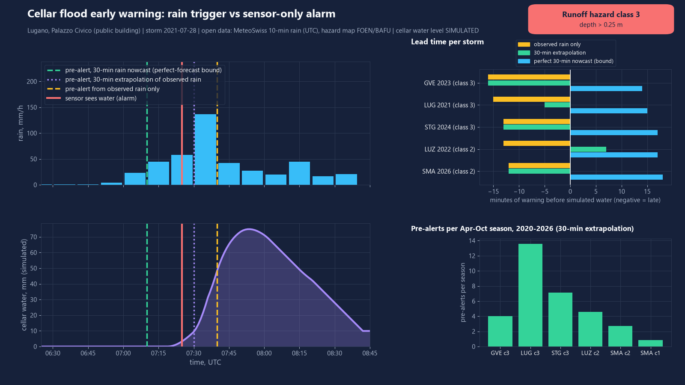
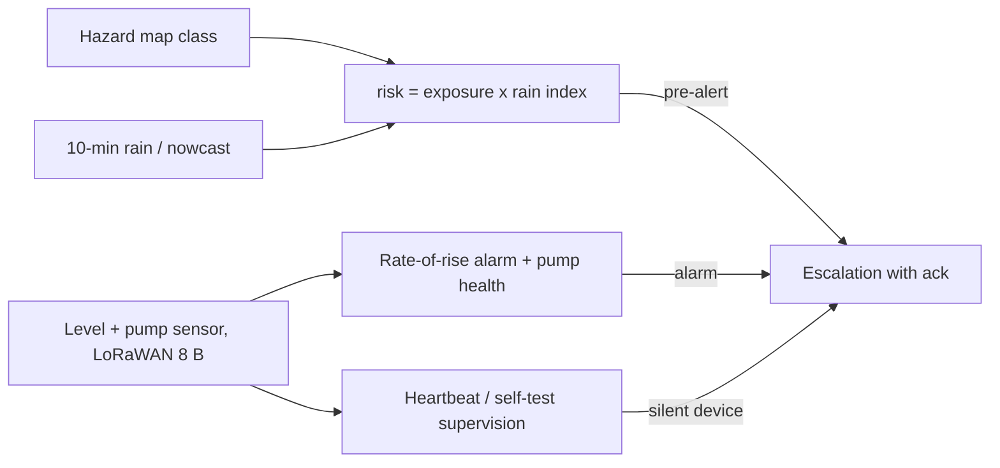

# cellar-flood-sentinel

Open-source cellar flood early warning: Swiss surface-runoff hazard map x heavy-rain trigger x a cheap water-level sensor, with a simulated LoRaWAN device fleet.



## What it does

- **Exposure lookup**: reads the FOEN/BAFU overland-flow hazard class (0-3) around any Swiss coordinate from the public map layer.
- **Risk score** = site exposure (hazard class x height of the lowest basement opening) x rain intensity-duration index. Levels: watch, pre-alert ("close barriers, move valuables"), severe.
- **Sensor side**: compact 8-byte LoRaWAN payload (water present, level, rate of rise, sump-pump current, pump run time, starts per hour, battery) with a Python codec and a JS decoder that share test vectors. ChirpStack-style MQTT envelope included.
- **Sensor-confirmed alarm** with rate-of-rise and ETA to a critical level; **sump-pump health** (dry run, overcurrent, long run, short cycling, pump not starting).
- **Escalation chain** with acknowledgement (occupant, property manager, insurer line) and **heartbeat / daily self-test** loss detection for a fleet.

## Results

Rain is real MeteoSwiss 10-min data, Apr-Oct seasons 2020-2026, five stations. Hazard class is read from the real map at six public-building coordinates. The cellar water level and the sensor are **simulated** (parameters in `cellar_flood/sim.py`), so "lead time" means: minutes between the pre-alert and the moment a simulated sensor first sees water.

Pre-alert threshold 1.0, 10 minutes of data latency assumed. Median over the five site/storm pairs where the model floods (`docs/results.json`):

| Trigger | Lead vs simulated sensor | Simulated water events warned in time (7 seasons, 6 sites, 73 events) |
|---|---|---|
| Observed rain only | -13 min (late) | 2 of 73 |
| Causal 30-min extrapolation of the last 10-min rate | -12 min (late; range -16 to +7) | 13 of 73 |
| Perfect 30-min nowcast (upper bound, not achievable) | +17 min (range +14 to +18) | 65 of 73 |

Heaviest-hour storm per station in the 2020-2026 archive (dates are UTC, 1-h rain from the MeteoSwiss file):

| Site (hazard class) | Date | Peak 1-h rain | Observed | Extrapolation | Perfect nowcast |
|---|---|---|---|---|---|
| Geneve, Hotel de Ville (3) | 2023-06-29 | 35.9 mm | -16 min | -16 min | +14 min |
| Lugano, Palazzo Civico (3) | 2021-07-28 | 55.3 mm | -15 min | -5 min | +15 min |
| St. Gallen, main station (3) | 2024-07-31 | 52.3 mm | -13 min | -13 min | +17 min |
| Luzern, main station (2) | 2022-08-26 | 44.9 mm | -13 min | +7 min | +17 min |
| Zuerich, Letzigrund (2) | 2026-06-30 | 30.8 mm | -12 min | -12 min | +18 min |
| Zuerich, Stadthaus (1, control) | 2026-06-30 | 30.8 mm | no water | no water | no water |

Pre-alerts over all 7 seasons (42 site-seasons): **2.6 per site and season**; **33%** of them (36 of 109) were followed by no simulated water. At threshold 0.7 it is 4.8 per season and 64% false; at 1.3 it is 1.6 and 9% false, but the perfect nowcast then warns only 53 of 73 events in time.

Other measured numbers:

| Item | Result |
|---|---|
| Battery life estimate (2 x AA lithium, hourly heartbeat, SF7) | 17.6 years; 14.1 years at SF10. Airtime 56.6 ms / 370.7 ms per 8-byte uplink. Estimate from assumed currents, not bench-measured |
| Simulated fleet, 40 devices x 30 days, 2% uplink loss | 6 of 6 dead devices flagged, median 239 min after the last uplink; 1 false "silent" flag; 5 of 5 injected pump faults found at the daily self-test, median 6.6 h after onset |
| Tests | 73 Python tests + 10 shared payload vectors in the JS decoder |

Reading the table honestly: on convective storms the rain gauge alone is **too late** for a sensor that sits at the cellar opening, because the 10-minute bucket closes about when the water arrives. What buys minutes is a nowcast, and its real skill is not measured here.

## Quick start

```bash
python -m venv .venv && .venv/Scripts/python -m pip install -e ".[dev]"    # Windows; use .venv/bin on Linux
python -m cellar_flood demo        # offline, reproduces every number and figure above (about 7 minutes)
python -m pytest -q                # 73 tests
node codec/test_decoder.js         # JS decoder against the shared vectors
python -m cellar_flood decode 45000c0300000081
python -m cellar_flood hazard 46.0053 8.9524      # live hazard lookup (network)
python -m cellar_flood nowcast 46.0053 8.9524     # live risk from a 15-min forecast (network)
python -m cellar_flood fetch       # re-download rain data and hazard tiles (network, ~250 MB)
```

## How it works



- Rain index = max over durations (10, 30, 60 min) of rain depth / reference depth (8, 15, 22 mm). Exposure factor = class factor (0.35, 0.6, 0.8, 1.0) x opening factor (sill height). Thresholds are engineering assumptions, not return periods.
- Hazard class is the worst runoff class covering at least 2% of a 20 m disc around the coordinate (the map marks the flow paths around a building, not the footprint).
- Simulation: linear reservoir of surface runoff with 10 min time constant, scaled so the hazard map's class depth (50, 175, 300 mm) is reached by an assumed 80 mm/h reference storm; water enters over a 100 mm sill; sump pump 1.5 mm/min above 30 mm. Sensitivity to time constant (5-20 min) and sill (50-150 mm) is in `docs/results.json`: perfect-nowcast lead stays between +13 and +24 min, observed-only stays late.
- Payload layout is documented in `cellar_flood/payload.py`; the JS decoder is `codec/decoder.js` (LoRaWAN `decodeUplink` form).

## Data sources

- Rain: MeteoSwiss open data, SwissMetNet automatic stations, parameter `rre150z0` (10-min precipitation, UTC), licence CC-BY. Source: MeteoSwiss, https://data.geo.admin.ch/ch.meteoschweiz.ogd-smn/ . Stations Geneve/Cointrin, Lugano, St. Gallen, Luzern, Zuerich/Fluntern; Apr-Oct 2020-2026 cached in `data/precip/`.
- Hazard: Source: FOEN/BAFU, layer `ch.bafu.gefaehrdungskarte-oberflaechenabfluss` (Overland flow map) on geo.admin.ch, read through the WMS (the layer has no feature-query API). Classes: 0-0.1 m, 0.1-0.25 m, > 0.25 m modelled water depth for an event rarer than 100 years. The map is a coarse, unverified model and "not legally binding". 120 m tile images around each site are cached in `data/hazard/`.
- Live nowcast option: Open-Meteo 15-min precipitation forecast (CC-BY 4.0), used only by the `nowcast` command, not in any result.
- Sites are public buildings with approximate coordinates (+-50 m); no private addresses. Cellar parameters are assumed generic values.

## What is not verified yet

- Whether any of these storms flooded a real cellar: the water level is simulated, no claims or sensor data were used. Storm dates are the heaviest 1-h rain per station in the archive; press coverage was not checked.
- Nowcast skill: the +17 min is a perfect-forecast bound. No archived nowcast was available, and the stitched Open-Meteo history is not a true lead-time forecast. The causal extrapolation baseline is a poor stand-in.
- False pre-alert rate is measured against the simulation, not against real water in real cellars.
- Hazard class depends on the exact coordinate; the licence terms for redistributing the small cached hazard tiles were not verified (the STAC entry says "proprietary"; federal geodata terms of use apply). Remove `data/hazard/` if in doubt.
- Radio and battery numbers use assumed datasheet-typical currents; no hardware was built or tested, no ultrasonic or pump-current sensor accuracy was measured.
- 10 min of data latency is an assumption about publication delay.
- Station-to-site distance is 0.6 to 5 km; convective rain cells can be smaller than that.

## Licence

MIT, Copyright (c) 2026 Victor Bonilla.
